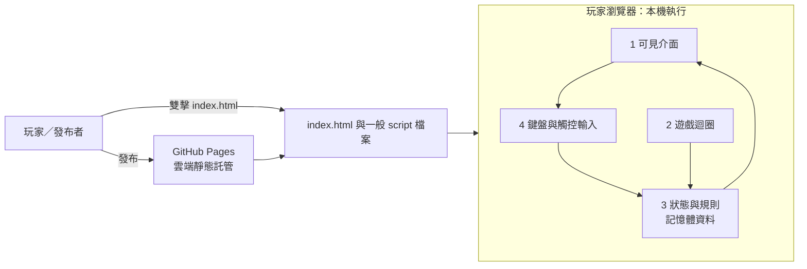

# 可愛貓咪俄羅斯方塊：六格架構

## 1. 誰用、解決什麼

- **誰用：**任何想玩的人。
- **解決什麼：**提供一款輕鬆、可愛、無壓力，打開就能玩的俄羅斯方塊遊戲。

## 2. 畫面

- **開始畫面：**展示貓咪主題、開始按鈕和操作提示。
- **遊戲畫面：**顯示棋盤、目前分數、下個方塊預覽，以及鍵盤和觸控操作提示。
- **暫停狀態：**可暫停並繼續遊戲。
- **結束畫面：**顯示結算分數、拉炮煙火和「再玩一次」按鈕。
- **視覺方向：**方塊使用貓咪 Emoji；其外觀可能因裝置而異。

## 3. 資料

- 遊戲進行時在瀏覽器記憶體保存棋盤、目前與下個方塊、分數及遊戲狀態。
- 第一版不保存分數或其他資料；重新整理或重新開局後不保留紀錄。
- 不需要資料庫、後端、API 金鑰或其他付費外部服務。

## 4. 零件

| 編號 | 零件 | 層 | 在哪裡跑 | 執行時由誰做 |
|---|---|---|---|---|
| 1 | 可見介面：先顯示貓咪主題開始畫面，再提供棋盤、分數、下個方塊、操作提示、暫停與結束畫面。 | 前端畫面 | 本機：雙擊 `index.html` 時在玩家瀏覽器；雲端：GitHub Pages 提供網頁，仍由玩家瀏覽器顯示。 | 一般程式繪製介面；人開啟遊戲。 |
| 2 | 遊戲迴圈：以固定速度更新方塊下落，並在暫停或結束時停止更新。 | 前端程式 | 玩家電腦的瀏覽器本機執行；GitHub Pages 只提供靜態檔案。 | 一般程式。 |
| 3 | 狀態與規則：管理七種基本方塊、棋盤、碰撞、固定、消行、計分和堆頂結束。 | 資料、前端程式 | 玩家電腦的瀏覽器本機記憶體。 | 一般程式。 |
| 4 | 輸入：處理鍵盤與觸控的移動、旋轉、加速／快速落下及暫停操作。 | 前端畫面、前端程式 | 玩家電腦的瀏覽器本機執行。 | 人操作；一般程式讀取並處理輸入。 |
| 5 | GitHub Pages 發布：託管同一份可離線開啟的靜態網頁，供玩家以網址遊玩。 | 外部服務 | 雲端：GitHub Pages。 | 人發起發布；一般程式提供靜態檔案。 |

### 零件做的順序

依序實作上表第 1 至第 5 個零件，沿用相同編號與範圍。第 1 個零件完成時，雙擊 `index.html` 就必須看得到貓咪主題開始畫面；不必等其他零件完成才有可見結果。

### 架構圖

## 5. 流程

1. 玩家雙擊 `index.html` 或開啟 GitHub Pages 網址，看到開始畫面與操作提示。
2. 玩家按「開始」，遊戲建立新棋盤並開始固定速度的下落迴圈。
3. 玩家用鍵盤或觸控移動、旋轉、加速／快速落下方塊；需要時可暫停或繼續。
4. 方塊碰撞後固定；完整的橫列消除並依消除行數加分，接著顯示下個方塊。
5. 方塊堆到頂端時停止遊戲，顯示分數與拉炮煙火。
6. 玩家按「再玩一次」開始新局；不延續前局分數或狀態。

## 6. 規則與驗收

### 遊戲規則

- 使用七種基本俄羅斯方塊；方塊下落速度固定。
- 方塊可移動和旋轉；觸底或碰到已固定方塊時固定，不能穿過棋盤邊界或已固定方塊。
- 完整橫列消除；消除影響到而變得不完整的方塊，可落入下方空格；消除列下方原有的方塊保持不動。單次消除 1／2／3／4 行分別得 100／300／500／800 分。
- 方塊堆到頂端即結束；不做暫存方塊（Hold）或跨局存檔。
- 建議操作：←／→ 移動、↓ 加速下落、↑ 旋轉、空白鍵快速落下、P 暫停／繼續；觸控提供相應按鈕。

### 驗收清單

- [ ] 雙擊 `index.html` 與 GitHub Pages 網址都能開啟遊戲，不依賴伺服器端程式。
- [ ] 開始畫面提供操作提示；遊戲畫面顯示棋盤、分數與下個方塊。
- [ ] 七種基本方塊可下落、移動、旋轉；碰撞後固定，完整橫列會消除。
- [ ] 鍵盤與觸控均能操作；暫停與繼續有效。
- [ ] 下落速度固定；消除 1／2／3／4 行分別增加 100／300／500／800 分。
- [ ] 方塊堆到頂端後遊戲停止，顯示分數與拉炮煙火；「再玩一次」會重設棋盤和分數。
- [ ] 重新整理不保存分數；沒有暫存方塊功能。
- [ ] 網頁使用一般 `<script src>` 載入 JavaScript，不用 `fetch` 讀本機檔案、不用 `type="module"` 或 `import`／`export`。
- [ ] 不需要金鑰、信用卡或付費服務。

## 之後再做

- 保存最高分或其他玩家資料。
- 暫存方塊（Hold）、難度／速度變化、更多動畫或音效。
- 自訂貓咪插圖（第一版使用 Emoji，顯示外觀可能依裝置不同）。
- 多人遊戲、排行榜、帳號、後端或任何需要金鑰的外部服務。
