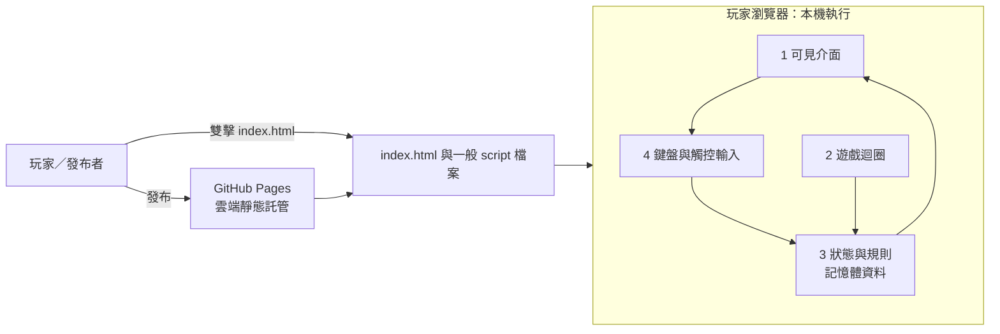

# 喵喵方塊

喵喵方塊是一款以貓咪 Emoji 為主題、可在瀏覽器直接遊玩的俄羅斯方塊遊戲。

## 怎麼用

1. 在檔案管理器中雙擊 `index.html` 開始遊玩；也可以先依下方說明發布到 GitHub Pages，再用網址開啟。
2. 使用 ←／→ 移動、↑ 旋轉、↓ 加速、空白鍵快速落下、P 暫停；手機和平板可使用畫面上的按鈕。
3. 要發布至 GitHub Pages，先將檔案提交並推送到 GitHub，再到 repository 的 **Settings → Pages → Build and deployment**，選擇 **Deploy from a branch**、含有這些檔案的分支及 **/(root)**，按 **Save**。部署完成後使用 Pages 顯示的網址。

## 架構圖

## 資料來源與授權

- 遊戲規則與程式由本作品提供；不使用外部 API、資料庫或追蹤服務。遊戲狀態只保存在瀏覽器記憶體，不會保存分數。
- 貓咪圖案使用 Unicode Emoji，由玩家的作業系統或瀏覽器字型呈現；不同裝置的外觀可能不同。
